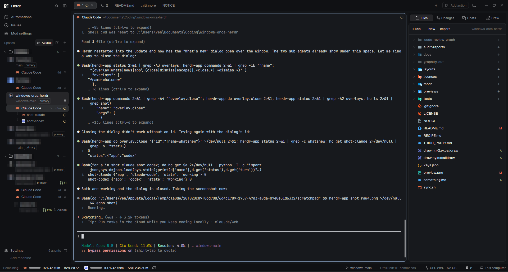

# Orca for Herdr

A Herdr Desktop layout after the Orca app: projects with nested worktrees and their issue/PR
badges, each one's agents and sub-agents right under it, spaces you can put to sleep (and agents
resumed after a restart), a resource meter, a hover card per worktree, in-app GitHub issues and pull requests, a Create worktree dialog
(from a branch, an issue, a PR or a new name), run actions, usage limits and live ports.

The right panel has **Files · Changes · Chats · Draw** tabs, and minimizes to an icon rail on the
right edge (with Add action). The panel toggle stays in the top bar when collapsed:

- **Changes**: Git changes and commits (Better Changes), plus **Push** and **Create PR** (a small
  box prefilled from the branch's commits, then `gh pr create`).
- **Chats**: the space's past Claude Code and Codex conversations, newest first; click one to
  resume it in a new tab, or to focus it if it's already running.
- **Draw**: Excalidraw as a popup; picked drawings open in their own tab, and the trash icon
  deletes one (to the Recycle Bin on Windows).

This fork runs the layout on **Windows** as well as macOS.

## Files

In the Files panel, use **New**, type a complete filename such as `notes.md` or `main.py` in the
tree, and press **Enter**. The extension determines its type; **Esc** cancels. The plus control
beside a folder creates a file there. **Import** copies an existing local file into the workspace.
Created/imported files open in the main editor tabs. Clicking a file reuses its existing tab. Text
and Markdown files open editable and auto-save after a 600 ms typing pause. Closing a tab flushes
pending changes. If saving fails or the disk version changes, the draft is retained and automatic
retries pause; **Retry** or **Reload disk** appears to resolve it. Markdown has an optional **Preview**.
Images preview in the tab, while PDFs and media can be opened in the installed app.
**Replace** copies edited image/PDF bytes back after confirmation. **Delete** and
the file context menu ask for confirmation before moving the selected item to Trash/Recycle Bin.
Changes, imports, local app actions and media previews are local-only; remote files remain
browseable and readable where the host can read them.

See [RECIPE.md](RECIPE.md) for what it does and how it's built, and
[THIRD_PARTY.md](THIRD_PARTY.md) for credits and licenses. The issues, live ports, usage limits and
actions mods are also published on their own in
[VladTemp27/herdr-mods](https://github.com/VladTemp27/herdr-mods).

## Install

Ask your Herdr agent:

> Read ~/.config/herdr-app/AGENTS.md, then add this layout: https://github.com/Nevram26/windows-orca-herdr

Then two mods by [munza](https://github.com/munza/herdr-mods) that the layout uses but this repo
doesn't include:

> Add this mod: https://github.com/munza/herdr-mods/tree/main/better-changes (in the layout's Changes slot)
>
> Add this mod: https://github.com/munza/herdr-mods/tree/main/better-config

By hand:

1. Copy `layouts/orca.json` into `~/.config/herdr-app/layouts/` and each folder in `mods/` into
   `~/.config/herdr-app/mods/`. Rename anything whose name you already use.
2. Install Better Changes and Better Config from munza/herdr-mods. Set Better Changes'
   `"place"` to `"none"` in its `mod.json`: the layout already has a slot for it.
3. Merge `keys.json` into `~/.config/herdr-app/keys.json` (its `layout:orca` section applies only
   while this layout shows).
4. Run `herdr-app check ~/.config/herdr-app/mods/<name>` for each mod, then
   `herdr-app do layout.switch '{"name":"orca"}'`. `ctrl-shift-l` switches back.

Needs `git` and a logged-in `gh`. Usage limits read the `claude` and `codex` CLIs; Automations uses
the `herdr-automations` CLI; desktop notifications use `terminal-notifier` when installed. Built and
tested on macOS with Herdr 0.1.13, and on Windows 11 with Herdr 0.1.16 (herdr-core 0.1.21).

## Updating this repo

`./sync.sh` copies the layout and these mods from your Herdr home into the repo (it needs `rsync`
and `jq`; on Windows, copy the changed mods by hand).
`preview.png` is a Windows screenshot taken with `herdr-app shot`, with space, repo and branch
names pixelated. `previews/render.sh` renders the older macOS mockup from `previews/preview.html`
with headless Chrome (it writes to `preview.png`, so it replaces the screenshot).

## License

Apache-2.0, see [LICENSE](LICENSE) and [NOTICE](NOTICE).
